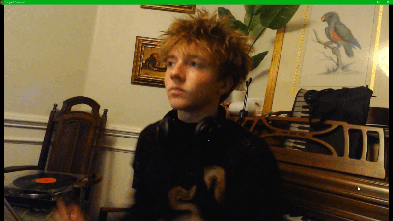

# wintd
inspired completely by ojrgb's "appletd" go star his repo its very cool :)


hands, face, pose, body masks and depth for touchdesigner on windows. runs in its own process so your project keeps its framerate, and installs itself with one button.

## install

1. download `wintd.tox` from this repo
2. drag it into your project
3. on the **wintd** page press **Install**. first time takes a few minutes, it grabs its own python and models into `%LOCALAPPDATA%\wintd` and never touches your python or your td install
4. turn on **Active**

that's it. hands are on by default. the overlay is on by default too, hit the big button on the node (or the **Overlay** toggle) to hide it.

needs windows 10/11 x64 and touchdesigner 2023 or newer. any gpu works, depth uses directml so nvidia, amd and intel are all fine.

## what comes out

| output | type | what |
| --- | --- | --- |
| `out1` | CHOP | every channel, see below |
| `video` | TOP | the camera, with the overlay on top when Overlay is on |
| `overlay` | TOP | just the overlay, transparent |
| `mask` | TOP | person mask (Body Mask stream) |
| `depth` | TOP | depth map, 0 far → 1 near (Depth stream) |
| `facemesh` | TOP | all 478 face points as a 478×1 float texture, ready for instancing |

channel names are flat and easy to select with wildcards:

```
h0_index_tip_x  h0_index_tip_y  h0_index_tip_z
h0_pinch  h0_pinch_amt  h0_open  h0_fist  h0_point  h0_peace  h0_spidey  h0_thumbsup
h0_palm_x  h0_palm_y  h0_angle  h0_vel_x  h0_vel_y  h0_speed  h0_push  h0_swipe_x  h0_swipe_y
hands_count  hands_dist  hands_angle  hands_center_x  hands_center_y  hands_clap
f_nose_x  f_l_iris_x  f_yaw  f_pitch  f_roll  f_mouth_open  bs_jawOpen  bs_eyeBlinkLeft ...
p_l_wrist_x  p_r_knee_y  p_l_shoulder_v ...
```

- `h0` is your left hand and `h1` your right (when Mirror is on, which it is by default). with Max Hands above 2, extra hands go in `h2`, `h3`
- `_x` `_y` are 0 to 1 with y going up, so they line up with how td thinks about images
- turn on **World Coords** for `_tx` `_ty` (centered, matches an orthographic camera with ortho width 1) and **Pixel Coords** for `_px` `_py`
- a hand that leaves the frame keeps all its channels at 0 with `_present` at 0, so nothing downstream breaks
- `bs_*` are the 52 face blendshapes (jawOpen, mouthSmileLeft, browInnerUp...)
- gestures are 0/1. `swipe` and `clap` pulse for a moment when they happen

## parameters

**wintd**: Install, Active, Overlay, Camera (+ Refresh Cameras), Resolution, FPS, Mirror

**Streams**: Hands, Max Hands, Face, Pose, Pose Model (lite / full), Body Mask, Depth, Smoothing, World Coords, Pixel Coords

**Record**: Record a take to a folder, Replay it back later without a camera, or turn on Fake Hands to build with no camera at all

**Advanced**: Install Folder, Python Override, OSC Port, Image Transport (auto / spout / shared memory), Restart, Open Log

streams turn on and off live, no restart. every stream is off until you turn it on, so you only pay for what you use.

## examples

in `examples/`, each one is a .toe you can open and pick apart.

1. **paint**: point your left hand at anything in the room, a loupe shows what you're aiming at with the hex code, pinch to grab that color. pinch with your right hand to draw. both fists clears
2. **synth**: right hand height picks one of 8 notes, pinch plays it, left hand fingers pick the chord. comes with `sheet.html`, a little flippable song sheet. easy mode shows numbers, musician mode shows the actual staff
3. **point cloud**: your room as a 3d point cloud from the depth stream. right hand turns it, spread both hands to zoom
4. **color portal**: the color portal from [ojrgb's tutorial](https://www.youtube.com/watch?v=uTyXW1rDakA), rebuilt on wintd. all credit for the effect goes to him

## why not just use the mediapipe plugin?

the mediapipe touchdesigner plugin runs its models inside a hidden chromium browser. every frame goes td → browser → back to td, and the results show up as json that python has to parse on td's main thread. that round trip and the python work are what DEMOLISH your frames.

wintd skips all of that:
- runs in its own process, so if it stalls your td project keeps rendering
- every stream (hands, face, pose, mask, depth) runs in its own process too, in parallel, instead of one after another
- opens the camera itself, no sending frames out of td and back
- hands, face, pose and masks run on mediapipe's native c++ runtime. depth runs on your gpu through onnxruntime + directml (nvidia, amd and intel)
- landmarks come in over osc into a stock osc in chop, zero python in your cook
- video comes in over spout, gpu to gpu. masks and depth come in through shared memory
- every stream is off until you turn it on, so you only pay for what you use
- press install and it grabs its own python + models, it never touches your setup

## running it without td

the tracker is a normal command line tool, handy for testing or for sending to td on another machine:

```
python -m wintd --list-cameras
python -m wintd --streams hands,face --camera 0
python -m wintd --synthetic --streams hands
python -m wintd --streams hands --host 192.168.1.20 --no-video
python -m wintd --record takes/wave --streams hands
python -m wintd --replay takes/wave --streams hands
```

ports: hands on 7400, pose on 7401, face on 7402, status on 7403, control on 7409. `--help` for everything else.

## how it works

```
camera ─► wintd (one process)
            ├─ hands   process ─► osc :7400
            ├─ pose    process ─► osc :7401
            ├─ face    process ─► osc :7402 + facemesh
            ├─ mask    process ─► shared memory
            ├─ depth   process ─► shared memory
            └─ video + overlay ─► spout
td: osc in chops + spout in + script tops ─► out1, video, overlay, mask, depth, facemesh
```

the camera frame goes to the stream processes through shared memory, each one runs on the newest frame it can get and never waits on the others. smoothing is a one euro filter per stream. if td closes, wintd notices and quits on its own so it never holds your camera.

## troubleshooting

- **Install failed**: hit **Open Log** on the Advanced page. most of the time it's a proxy or antivirus blocking the python or model download
- **no video**: another app has the camera (discord, obs, a browser tab). close it and hit Restart
- **channels show up with a `/` in front**: they're stripped inside the component already, but if you use your own osc in chop set it up the same way
- **spout doesn't work on your machine**: set Image Transport to Shared Memory
- **only run one wintd at a time**: two projects (or two td windows) with wintd active fight over the same ports and camera, the second one gets nothing. close the other one or change OSC Port on the Advanced page

## thanks

thanks to **@ojrgb** for developing "appletd" (uses apple NN's and has no framedrop, good if ur using a mac) check out his repo which inspired this one.

## license

MIT
